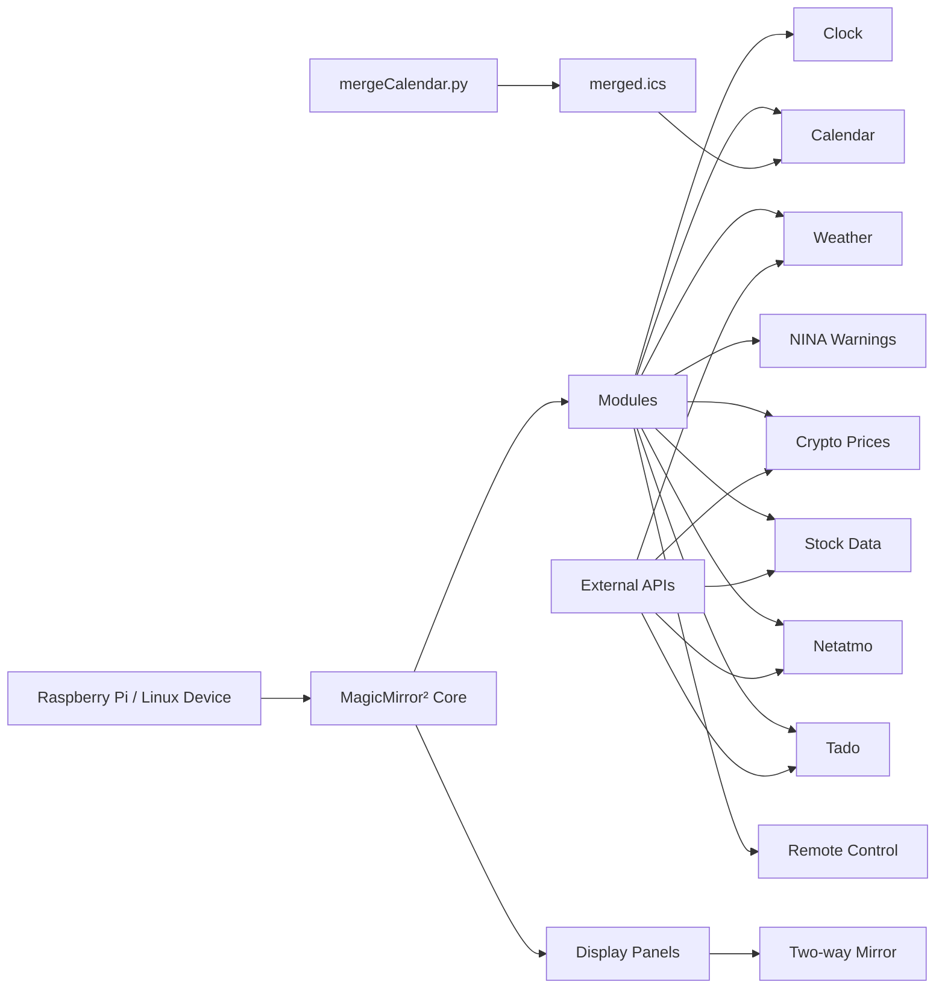

Magic Mirror
IP: <MAGICMIRROR_IP>
SSH: Port 22
VNC: DirectX11
FileTransfer over sftp


Nutzer: dany
PW: <im Passwortmanager>

# Magic Mirror Dashboard

A custom MagicMirror² smart mirror dashboard built with multiple displays, Raspberry Pi boards, a two-way mirror, and a custom wooden frame.

The mirror displays useful daily information such as calendar events, weather, emergency warnings, cryptocurrency prices, stock data, and smart home climate information while still looking like a regular wall mirror.

<p align="center">
  
</p>

---

## Table of Contents

- [About the Project](#about-the-project)
- [Features](#features)
- [Hardware](#hardware)
- [Hardware Costs](#hardware-costs)
- [Build Process](#build-process)
- [Architecture](#architecture)
- [Software Stack](#software-stack)
- [Repository Structure](#repository-structure)
- [Security Notice](#security-notice)
- [Installation](#installation)
- [Configuration](#configuration)
- [Calendar Merge Script](#calendar-merge-script)
- [Running MagicMirror](#running-magicmirror)
- [Autostart with systemd](#autostart-with-systemd)
- [Troubleshooting](#troubleshooting)
- [Useful Links](#useful-links)
- [Roadmap](#roadmap)
- [License](#license)

---

## About the Project

This project documents my personal Magic Mirror setup.

The goal was to build a clean smart mirror that blends into the room and shows important information at a glance. The setup is based on MagicMirror² and several third-party modules. It uses a custom hardware build with displays mounted behind a two-way mirror and powered by Raspberry Pi boards.

The project includes:

- MagicMirror² configuration
- helper scripts
- startup scripts
- calendar merging
- module documentation
- hardware build notes
- cost overview
- setup and troubleshooting instructions

---

## Features

- Smart mirror dashboard
- Multiple display areas behind the mirror
- Calendar view with merged `.ics` calendars
- German public holiday calendar integration
- Weather forecast
- NINA emergency warnings
- Cryptocurrency prices
- Stock market overview
- Netatmo smart home climate data
- Tado smart thermostat data
- Remote control support
- Optional support for multiple MagicMirror configurations

---

## Hardware

The hardware setup consists of a large two-way mirror with multiple display panels mounted behind it. The electronics are mounted on the back side of the mirror and hidden using a light-blocking black foil.

### Main Components

| Component | Description |
|---|---|
| Two-way mirror / spy mirror glass | Front mirror surface that allows the displays to shine through |
| Wooden frame | Custom frame for holding the mirror, displays, boards, and cables |
| Display panels / monitors | Mounted behind the mirror to show the MagicMirror dashboard |
| Raspberry Pi boards | Run MagicMirror² and output the dashboard to the displays |
| Display controller boards | Used for driving the display panels, depending on the panel type |
| Power supplies | Provide power for the displays, Raspberry Pis, and controllers |
| HDMI / display cables | Connect Raspberry Pis or controllers to the displays |
| USB cables | Power and data connections |
| Light-blocking foil | Prevents unwanted light leakage through the mirror |
| Tape / cable management | Holds cables and boards in place |
| Wall mounting hardware | Used to mount the finished mirror securely |

> Adjust the table above to match your exact parts and models.

---

## Hardware Costs

The exact costs depend heavily on the display size, mirror glass, frame material, and whether parts were bought new or reused.

This is a suggested bill of materials. Replace the example prices with the actual prices you paid.

| Part | Quantity | Estimated Cost per Unit | Estimated Total | Notes |
|---|---:|---:|---:|---|
| Two-way mirror / spy mirror glass | 1 | 80–200 € | 80–200 € | Depends on size and quality |
| Display panels / monitors | 2 | 40–120 € | 80–240 € | Used monitors can reduce cost |
| Raspberry Pi | 2 | 40–90 € | 80–180 € | Depends on model and availability |
| MicroSD cards | 2 | 8–15 € | 16–30 € | 32 GB or larger recommended |
| Power supplies | 2–4 | 10–25 € | 20–100 € | For Raspberry Pis and displays |
| Display controller boards | 2 | 20–50 € | 40–100 € | Only needed for raw display panels |
| HDMI / display cables | 2–4 | 5–15 € | 10–60 € | Depends on layout |
| USB / power cables | several | 5–20 € | 10–50 € | Cable length depends on build |
| Wooden frame material | 1 | 20–80 € | 20–80 € | Depends on wood and size |
| Light-blocking black foil | 1 | 10–30 € | 10–30 € | Used to block unwanted light |
| Tape / cable management | 1 | 5–20 € | 5–20 € | Cable clips, tape, ties |
| Wall mounting hardware | 1 | 10–40 € | 10–40 € | Use proper mounting for the final weight |

### Estimated Total

| Scenario | Estimated Total |
|---|---:|
| Budget build with reused parts | 250–400 € |
| Mid-range build | 400–700 € |
| New parts / larger mirror | 700 €+ |

> These are rough estimates. Add your actual prices once you have your final parts list.

---

## Build Process

### 1. Wiring

The first step was mounting the displays, Raspberry Pis, power supplies, controller boards, and cables on the back side of the mirror.

The cables are routed along the frame and fixed in place to keep the setup clean and serviceable.

<p align="center">
  
</p>

### 2. Light Blocking

To prevent unwanted light from shining through the mirror, the back side was covered with a light-blocking black foil.

Only the display areas remain visible through the two-way mirror glass.

<p align="center">
  
</p>

### 3. Final Result

The final result looks like a normal mirror but displays useful dashboard information.

<p align="center">
  
</p>

---

## Architecture



### Data Flow

1. MagicMirror² starts on the Raspberry Pi or Linux device.
2. Configured modules load data from local files or external APIs.
3. `mergeCalendar.py` merges multiple `.ics` calendar sources into one `merged.ics`.
4. The MagicMirror calendar module reads the merged calendar file.
5. The dashboard is shown on displays mounted behind the two-way mirror.

---

## Software Stack

- MagicMirror²
- Node.js
- npm
- Python 3
- Raspberry Pi OS or another Linux distribution
- systemd for autostart
- Third-party MagicMirror modules

### MagicMirror Modules Used

| Module | Purpose |
|---|---|
| `alert` | Default alert module |
| `clock` | Displays current time |
| `calendar` | Displays calendar entries |
| `MMM-CoinMarketCap` | Cryptocurrency prices |
| `MMM-AVStock` | Stock data and charts |
| `MMM-NINA` | German emergency warnings |
| `MMM-WetterOnline` | Weather forecast |
| `MMM-Remote-Control` | Remote control interface |
| `netatmo` / `MMM-Netatmo` | Netatmo climate data |
| `MMM-Tado` | Tado thermostat data |

---

## Repository Structure

Recommended structure:

```bash
.
├── README.md
├── images/
│   ├── wiring.jpg
│   ├── back-cover.jpg
│   └── final-result.jpg
├── config/
│   ├── config.example.js
│   ├── config-left.example.js
│   └── config-right.example.js
├── scripts/
│   ├── mergeCalendar.py
│   └── start-magicmirror.sh
├── systemd/
│   └── magicmirror.service
├── .env.example
└── .gitignore
```

Files that should usually stay private:

```bash
.env
config/config.js
config/config-left.js
config/config-right.js
FileZilla*.xml
*.log
```

---

Recommended `.gitignore`:

```gitignore
.env
*.env

config/config.js
config/config-left.js
config/config-right.js

FileZilla*.xml
*.log

node_modules/
.DS_Store
```

---

## Installation

### 1. Install MagicMirror²

Clone MagicMirror²:

```bash
git clone https://github.com/MagicMirrorOrg/MagicMirror.git ~/MagicMirror
cd ~/MagicMirror
npm install
```

Create a config file:

```bash
cp config/config.js.sample config/config.js
```

Start MagicMirror:

```bash
npm start
```

### Alternative: Community Installer

You can also use the community installation script:

```bash
bash -c "$(curl -sL https://raw.githubusercontent.com/sdetweil/MagicMirror_scripts/master/raspberry.sh)"
```

Repository:

```text
https://github.com/sdetweil/MagicMirror_scripts
```

Official website:

```text
https://magicmirror.builders/
```

Official documentation:

```text
https://docs.magicmirror.builders/
```

---

## Installing Third-Party Modules

Third-party modules are installed inside the MagicMirror `modules` directory.

Example:

```bash
cd ~/MagicMirror/modules
git clone <module-repository-url>
cd <module-folder>
npm install
```

Some modules do not require `npm install`. Always check the README of the module.

Useful module lists:

```text
https://github.com/MagicMirrorOrg/MagicMirror/wiki/3rd-party-modules
https://kristjanesperanto.github.io/MagicMirror-3rd-Party-Modules/
```

---

## Configuration

Create your real config from an example file:

```bash
cp config/config.example.js config/config.js
```

Replace all placeholders with your own values.

Example using environment variables:

```js
{
  module: "MMM-CoinMarketCap",
  position: "top_left",
  header: "Cryptocurrencies",
  config: {
    apiKey: process.env.COINMARKETCAP_API_KEY,
    currencies: ["bitcoin", "ethereum", "solana"],
    conversion: "EUR"
  }
}
```

Example calendar configuration:

```js
{
  module: "calendar",
  header: "Calendar",
  position: "top_left",
  config: {
    calendars: [
      {
        symbol: "calendar-check",
        url: "webcal://localhost:8080/modules/Calendar/merged.ics"
      }
    ],
    maximumEntries: 20,
    maximumNumberOfDays: 30
  }
}
```

---

## Calendar Merge Script

The repository includes a Python helper script to merge multiple `.ics` sources into one calendar file.

### Install Python dependencies

```bash
pip3 install requests icalendar
```

### Example script location

```bash
scripts/mergeCalendar.py
```

### Example calendar sources

```python
input_sources = [
    "https://example.com/private-calendar.ics",
    "https://ics.tools/Feiertage/bayern.ics"
]
```

### Output file

```python
output_file = "/home/dany/MagicMirror/modules/Calendar/merged.ics"
```

### Run manually

```bash
python3 scripts/mergeCalendar.py
```

### Optional cron job

Run every 15 minutes:

```bash
crontab -e
```

```cron
*/15 * * * * /usr/bin/python3 /home/dany/MagicMirror/scripts/mergeCalendar.py >> /home/dany/MagicMirror/calendar-merge.log 2>&1
```

---

## Running MagicMirror

### Run with a specific config

```bash
cd ~/MagicMirror

export DISPLAY=:0
export MM_CONFIG_FILE=config/config-left.js

DISPLAY=:0 npm start -- --config /home/dany/MagicMirror/config/config-left.js
```

---

## Startup Script

Create a startup script:

```bash
nano /home/dany/MagicMirror/start-magicmirror.sh
```

Single instance:

```bash
#!/usr/bin/env bash
set -euo pipefail

export DISPLAY=:0
export MM_CONFIG_FILE=config/config-left.js

cd /home/dany/MagicMirror

exec npm start -- --config /home/dany/MagicMirror/config/config-left.js
```

Make it executable:

```bash
chmod +x /home/dany/MagicMirror/start-magicmirror.sh
```

---

## Running Two Instances

If the setup uses two display areas or two different layouts, two MagicMirror instances can be started with separate configs.

```bash
#!/usr/bin/env bash
set -euo pipefail

export DISPLAY=:0

cd /home/dany/MagicMirror

npm start -- --config /home/dany/MagicMirror/config/config-left.js &
LEFT_PID=$!

npm start -- --config /home/dany/MagicMirror/config/config-right.js &
RIGHT_PID=$!

wait "$LEFT_PID" "$RIGHT_PID"
```

---

## Autostart with systemd

Create a systemd service:

```bash
sudo nano /etc/systemd/system/magicmirror.service
```

Example:

```ini
[Unit]
Description=MagicMirror Dashboard
After=network-online.target graphical.target
Wants=network-online.target

[Service]
Type=simple
User=dany
WorkingDirectory=/home/dany/MagicMirror
Environment=DISPLAY=:0
ExecStart=/home/dany/MagicMirror/start-magicmirror.sh
Restart=always
RestartSec=10

[Install]
WantedBy=graphical.target
```

Enable and start:

```bash
sudo systemctl daemon-reload
sudo systemctl enable magicmirror.service
sudo systemctl start magicmirror.service
```

Check logs:

```bash
journalctl -u magicmirror.service -f
```

Restart:

```bash
sudo systemctl restart magicmirror.service
```

---

## Troubleshooting

### MagicMirror does not start

Run it manually:

```bash
cd ~/MagicMirror
npm start
```

Check systemd logs:

```bash
journalctl -u magicmirror.service -f
```

### Display stays black

Check the display variable:

```bash
echo $DISPLAY
```

Try starting manually:

```bash
DISPLAY=:0 npm start
```

### A module does not load

Start MagicMirror in development mode:

```bash
npm run start:dev
```

Open the developer console and check for JavaScript errors.

### Calendar is empty

Check whether the merged calendar exists:

```bash
ls -la /home/dany/MagicMirror/modules/Calendar/merged.ics
```

Run the merge script manually:

```bash
python3 /home/dany/MagicMirror/scripts/mergeCalendar.py
```

### Remote control does not work

Check the MagicMirror network settings:

```js
address: "localhost",
ipWhitelist: ["127.0.0.1", "::ffff:127.0.0.1", "::1"]
```

For local network access, adjust `address` and `ipWhitelist` carefully. Do not expose the dashboard publicly without proper authentication and network security.

---

## Useful Links

- MagicMirror² website: https://magicmirror.builders/
- MagicMirror² documentation: https://docs.magicmirror.builders/
- MagicMirror² GitHub: https://github.com/MagicMirrorOrg/MagicMirror
- Community installer: https://github.com/sdetweil/MagicMirror_scripts
- Third-party modules: https://github.com/MagicMirrorOrg/MagicMirror/wiki/3rd-party-modules
- Searchable third-party module list: https://kristjanesperanto.github.io/MagicMirror-3rd-Party-Modules/

---

## Roadmap

Possible future improvements:

- move all secrets to environment variables
- add a clean `config.example.js`
- add an installation script for required modules
- add automatic calendar merging with systemd timer or cron
- add a complete parts list with exact prices
- add backup and restore instructions
- add screenshots of different layouts
- add secret scanning before publishing
- improve cable management
- add temperature monitoring for the mirror enclosure

---

## License

This repository contains my personal MagicMirror² setup, configuration examples, helper scripts, and documentation.

MagicMirror² and all third-party modules belong to their respective authors and are licensed separately. Check each project or module repository for its license.
