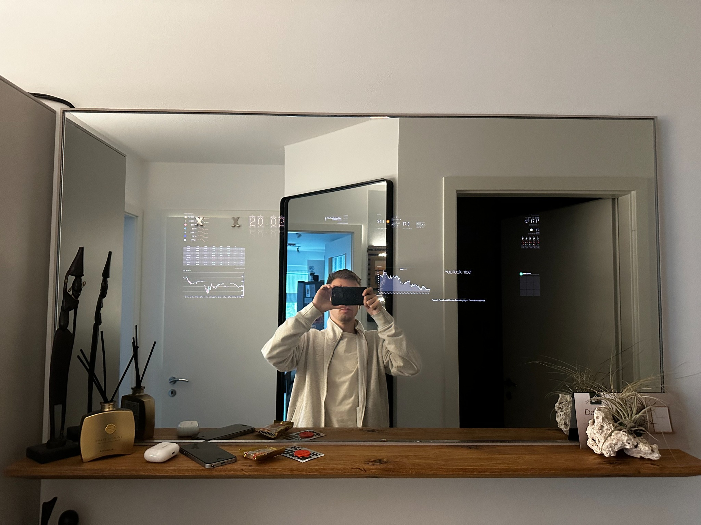
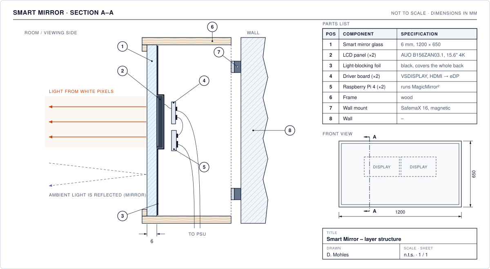
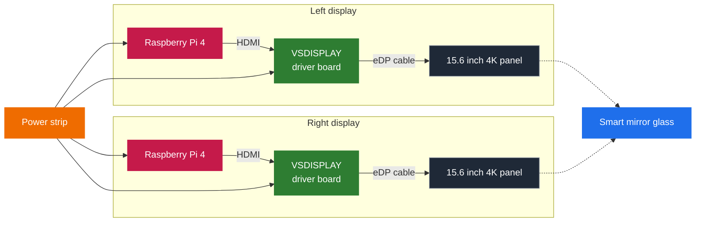
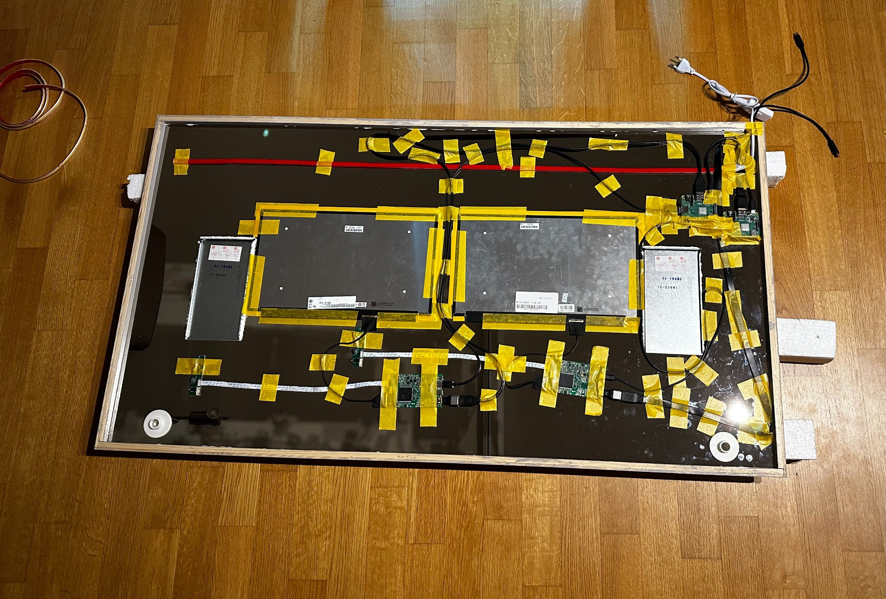
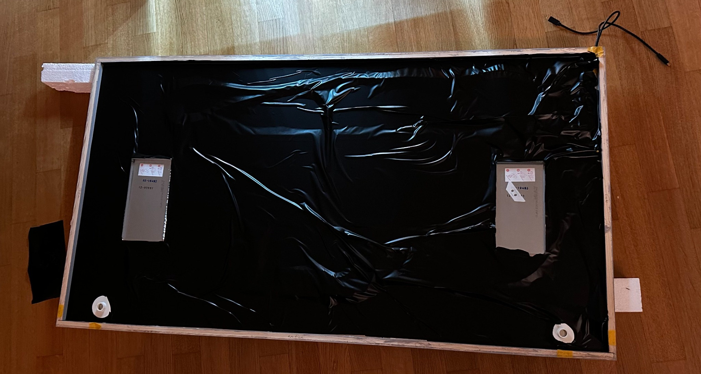
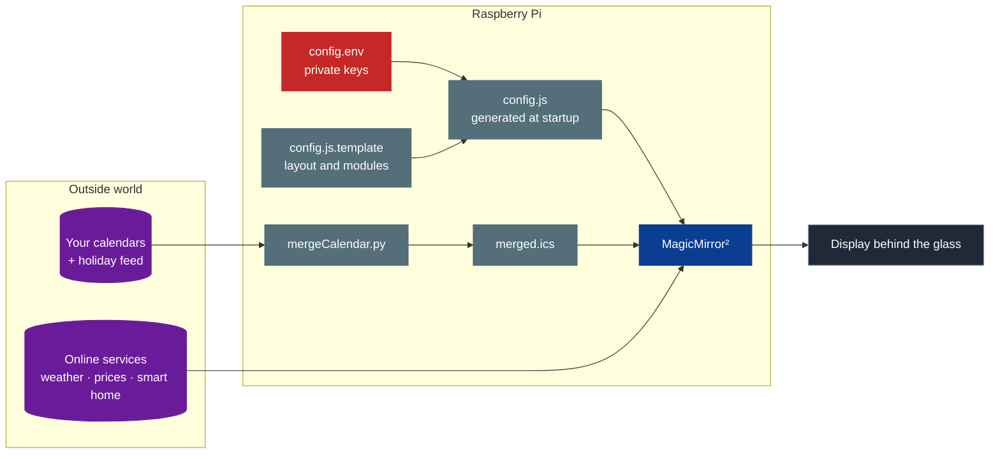
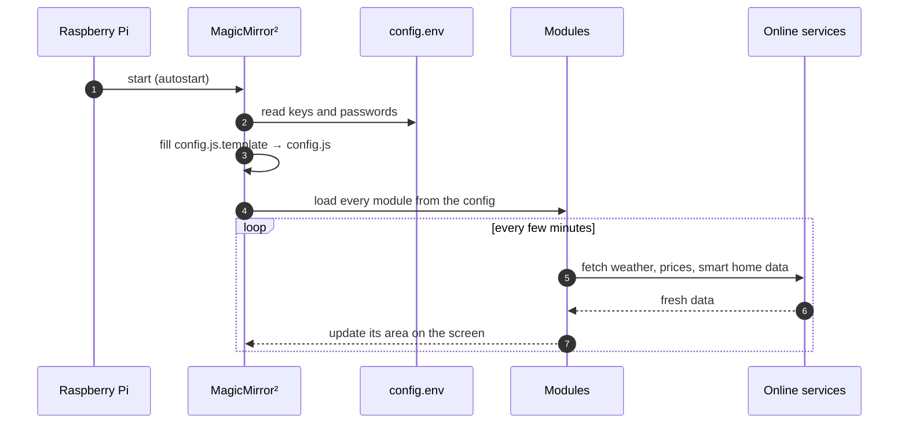

<div align="center">

# 🪞 Magic Mirror

**A wall mirror that shows your day: calendar, weather, warnings, markets and smart home.**

Built with two Raspberry Pis, two screens behind 6 mm smart mirror glass and the free software [MagicMirror²](https://magicmirror.builders/).

[](https://magicmirror.builders/)
[](https://www.raspberrypi.com/)
[](https://nodejs.org/)
[](https://www.python.org/)
[](https://github.com/dev-dany97/smart-mirror/actions/workflows/tests.yml)
[](LICENSE)



[How it works](#how-a-smart-mirror-works) •
[Features](#features) •
[Hardware](#hardware) •
[Software](#software) •
[Setup](#setup-step-by-step) •
[Tests](#tests) •
[Troubleshooting](#troubleshooting) •
[License](#license)

</div>

---

## How a smart mirror works

A smart mirror looks like a normal mirror. But behind the glass there are screens. Their white text shines through the glass, everything black stays hidden. The drawing shows how the parts are stacked.

<p align="center">
  
</p>

---

## Features

The dashboard is made of small blocks called **modules**. Each module shows one thing in its own part of the screen.

| Feature | Module | Data source |
|---|---|---|
| Clock and date | `clock` (built in) | Raspberry Pi system time |
| Appointments and public holidays | `calendar` (built in) | One merged calendar file (see [calendar script](#step-5-optional-merge-several-calendars)) |
| Pop-up notifications | `alert` (built in) | Other modules |
| Weather and 3-day forecast | `MMM-WetterOnline` | wetteronline.de |
| Official warnings | `MMM-NINA` | German warning app NINA |
| Crypto prices with charts | `MMM-CoinMarketCap` | CoinMarketCap API |
| Stock prices and candlestick chart | `MMM-AVStock` | Stock market data |
| Indoor climate | `netatmo` | Netatmo weather station |
| Room temperature and heating | `MMM-Tado` | tado° smart thermostats |
| Control the mirror from a phone | `MMM-Remote-Control` | Local web interface |

> **Want something else?** There are hundreds of modules for news, trains, Spotify, fitness and more. You find them all in the **[MagicMirror² module overview](https://modules.magicmirror.builders/)** and in the [official wiki](https://github.com/MagicMirrorOrg/MagicMirror/wiki/3rd-party-modules).

---

## Hardware

### Parts list

| Part | Used in this build | Qty | Price |
|---|---|:-:|---:|
| Mirror glass | Smart mirror special glass, 6 mm, 120 × 65 cm ([Spiegelshop24](https://www.spiegelshop24.com/)) | 1 | **309.00 €** |
| Display driver board | VSDISPLAY USB-C/HDMI board with brightness control (sold for NV156QUM-N32 / -N72, works with the panels below) | 2 | **79.90 €** each |
| Display panels | AUO B156ZAN03.1, 15.6" 4K UHD (3840 × 2160) IPS, 40-pin eDP | 2 | approx. 40–120 € each |
| Computer | Raspberry Pi 4 with microSD card | 2 | approx. 50–100 € each |
| Power | Anker 100 W power supply, power strip | – | approx. 30–80 € |
| Cables | HDMI, eDP ribbon and USB cables | – | approx. 10–40 € |
| Wall mounting | SafemaX® 16 magnetic mounting set (for mirrors up to 1.6 m² and 6 mm) | 1 | **26.95 €** |
| Frame and finish | Wooden frame, black foil, tape, cable duct | – | approx. 30–100 € |
| | | | **Total approx. 750–1,150 €** |

> **Why panels instead of monitors?** A bare panel is thin and light. It can lie flat on the glass. The driver board changes the HDMI signal of the Pi into eDP for the panel. The VSDISPLAY boards also have buttons for the brightness. So you can set both screens to the same level.

### Wiring



> **Important: the screens need their own power supply.** The Raspberry Pi is not strong enough to power the screens. If it tries, voltage spikes during boot can make the Pi restart again and again or turn the screens on and off. Connect the driver boards directly to the power supply. Use a good and strong power supply. This build uses an Anker 100 W.

### Build steps

<table>
<tr>
<td width="33%" align="center"><b>1 · Mount and wire the electronics</b></td>
<td width="33%" align="center"><b>2 · Cover the back with black foil</b></td>
<td width="33%" align="center"><b>3 · Hang it and switch it on</b></td>
</tr>
<tr>
<td></td>
<td></td>
<td></td>
</tr>
<tr>
<td valign="top">

The two panels lie directly on the back of the glass where the text should appear. The driver boards, Raspberry Pis and the power supply sit around them. All cables run along the frame and are held with tape.

The red strip in the photo is an LED strip. In the end I did not use it because it was much too bright and did not look good.

✓ Panels flat against the glass<br>
✓ Displays powered separately<br>
✓ Cables tidy and fixed

</td>
<td valign="top">

The whole back is covered with black foil, also over the panels. From the front the glass now looks like a real mirror and you cannot see the electronics.

✓ No gaps where light gets through<br>
✓ Air can still reach the Raspberry Pis<br>
✓ Foil smooth around the panels

</td>
<td valign="top">

Magnetic mounts hold the mirror on the wall. So you can take it off easily for repairs. From the front it looks like a normal mirror with the dashboard inside the glass.

✓ Wall mounts strong enough for the weight<br>
✓ Power cable hidden<br>
✓ Same brightness on both screens

</td>
</tr>
</table>

> **Tip:** If you want an LED strip for extra light, choose one that is not too bright or can be dimmed. A strong strip looks bad very quickly.

> **Tip:** Use a pure black background. Every bright pixel shines through the glass. Every black pixel stays invisible.

---

## Software

[MagicMirror²](https://magicmirror.builders/) is free software made for smart mirrors. In short:

1. MagicMirror² is a small **web app**. It runs on the Raspberry Pi and is shown in full screen.
2. **Modules** add the widgets. Some are built in. Hundreds more come from the community.
3. **One config file** says which modules are used, where they appear and how they are set up.
4. Online services like CoinMarketCap, Netatmo and tado° need **API keys or logins**. They are stored in a separate private file called `config.env`. So the config can be shared without secrets.
5. A small **Python script** puts several calendars into one file for the calendar module.



<details>
<summary><b>What happens when the mirror starts? (click to open)</b></summary>



</details>

### Repository contents

```text
.
├── config/
│   ├── config.js.template    MagicMirror² config with all modules and their layout
│   └── config.env.example    All keys and passwords you need to fill in
├── scripts/
│   └── mergeCalendar.py      Puts several calendars into one merged.ics file
├── tests/                    Tests for the config and the calendar script
├── docs/images/              Build photos
├── extras/
│   └── filezilla-sftp-profile.xml   Optional FileZilla profile to copy files to the Pi
├── .github/workflows/        Runs the tests on GitHub after every push
├── LICENSE
└── README.md
```

MagicMirror² and the modules are **not** part of this repository. You install them from their official sources (steps 2 and 3 below).

---

## Setup step by step

You need a Raspberry Pi with Raspberry Pi OS (with desktop). It must be connected to the internet and to the screen. You type all commands below in a terminal on the Pi or over SSH.

### Step 1: Prepare the Raspberry Pi

Write **Raspberry Pi OS (64-bit, with desktop)** to the microSD card with the [Raspberry Pi Imager](https://www.raspberrypi.com/software/). In the Imager settings you can set a user name and Wi-Fi and turn on SSH. Then start the Pi and update it:

```bash
sudo apt update && sudo apt full-upgrade -y
```

### Step 2: Install MagicMirror²

The easiest way is the community installer. It installs Node.js and MagicMirror² in one step:

```bash
bash -c "$(curl -sL https://raw.githubusercontent.com/sdetweil/MagicMirror_scripts/master/raspberry.sh)"
```

Or install it by hand as shown in the [official guide](https://docs.magicmirror.builders/getting-started/installation.html):

```bash
git clone https://github.com/MagicMirrorOrg/MagicMirror.git ~/MagicMirror
cd ~/MagicMirror
npm run install-mm
```

### Step 3: Install the modules

Every module goes into `~/MagicMirror/modules`:

```bash
cd ~/MagicMirror/modules
git clone <repository URL of the module>
cd <module folder>
npm install
```

Install these modules: `MMM-CoinMarketCap`, `MMM-AVStock`, `MMM-NINA`, `MMM-WetterOnline`, `MMM-Remote-Control`, `netatmo` (MMM-Netatmo) and `MMM-Tado`. Search for each name in the **[module overview](https://modules.magicmirror.builders/)**. There you find the link and the instructions. Run `npm install` only if the module README says so.

You can skip any module you don't need. Just remove its block from the config in step 4.

### Step 4: Add the configuration and your own keys

Clone this repository and copy the two config files into MagicMirror²:

```bash
git clone https://github.com/dev-dany97/smart-mirror.git ~/smart-mirror
cp ~/smart-mirror/config/config.js.template ~/MagicMirror/config/
cp ~/smart-mirror/config/config.env.example ~/MagicMirror/config/config.env
nano ~/MagicMirror/config/config.env
```

Fill in your own values in `config.env`. Each module that uses an online service needs its own key or login. The module README tells you how to get it.

| Variable | What it is for |
|---|---|
| `COINMARKETCAP_API_KEY` | API key for the crypto prices (`MMM-CoinMarketCap`) |
| `AVSTOCK_PURCHASE_PRICES` | Your purchase prices for the stocks (`MMM-AVStock`) |
| `REMOTE_CONTROL_API_KEY` | Secret key for the remote control (`MMM-Remote-Control`) |
| `NETATMO_CLIENT_ID`, `NETATMO_CLIENT_SECRET`, `NETATMO_REFRESH_TOKEN` | Login data for the weather station (`MMM-Netatmo`) |
| `TADO_USERNAME`, `TADO_PASSWORD` | Login data for the heating (`MMM-Tado`) |

When MagicMirror² starts it replaces every `${VARIABLE}` in `config.js.template` with the value from `config.env`. The result is saved as `config/config.js`. More details are in the [MagicMirror² docs](https://docs.magicmirror.builders/configuration/introduction.html#enviromnent-variables).

To change what the mirror shows edit `config.js.template`. The most important settings:

| Setting | Module | Meaning |
|---|---|---|
| `position` | all | Where the module appears (for example `top_left`, `top_right` or `bottom_center`) |
| `city` | `MMM-WetterOnline` | Your town |
| `ags` | `MMM-NINA` | Official number of your town or region |
| `symbols`, `alias` | `MMM-AVStock` | The stocks you want to follow |
| `currencies` | `MMM-CoinMarketCap` | The cryptocurrencies you want to follow |

### Step 5 (optional): Merge several calendars

The calendar module shows one calendar file. `scripts/mergeCalendar.py` puts several calendars into this file:

- local folders with `.ics` files (for example from iCloud or Google, synced with [vdirsyncer](https://github.com/pimutils/vdirsyncer))
- online `.ics` links (for example public holidays)

1. Install the dependencies:

   ```bash
   pip3 install requests icalendar
   ```

2. Open the script and change the two settings at the bottom: `input_sources` (your calendar folders and links) and `output_file`. The output file must be inside `~/MagicMirror/modules/` because MagicMirror² shares this folder. The calendar module then reads it from `webcal://localhost:8080/modules/Calendar/merged.ics`.

3. Run it once to test it. Then let it run every 15 minutes:

   ```bash
   python3 ~/smart-mirror/scripts/mergeCalendar.py
   crontab -e
   ```

   ```cron
   */15 * * * * /usr/bin/python3 /home/<user>/smart-mirror/scripts/mergeCalendar.py
   ```

### Step 6: Start the mirror

Start MagicMirror² by hand to check that everything works:

```bash
cd ~/MagicMirror
DISPLAY=:0 npm start
```

To start it every time the Pi boots use [pm2 as shown in the official docs](https://docs.magicmirror.builders/configuration/autostart.html). The installer from step 2 can set this up for you.

> **Two screens:** In this build each screen has its own Raspberry Pi. Each Pi runs its own MagicMirror² with its own config (left and right side). If you use one Pi for both screens start two instances. Each one needs its own config file and its own `port`:
>
> ```bash
> DISPLAY=:0 MM_CONFIG_FILE=config/config-left.js npm start &
> DISPLAY=:0 MM_CONFIG_FILE=config/config-right.js npm start &
> ```

---

## Tests

Tests check that a change did not break anything. They run on GitHub after every push (see the badge at the top). You can also run them on your computer.

| Test | What it checks |
|---|---|
| **MagicMirror config** | The template turns into valid JavaScript. Every `${VARIABLE}` exists in `config.env.example`. All modules have a valid position. No password or key is written directly into the template. |
| **Calendar merge script** | Folders, single `.ics` files and links are merged correctly. Only the main fields are copied. Broken sources and dead links are skipped without a crash. |
| **Secret scan** | [gitleaks](https://github.com/gitleaks/gitleaks) searches the whole history for passwords and API keys. |

Run them on your computer:

```bash
npm test
pip install -r requirements-dev.txt
pytest
```

---

## Troubleshooting

| Problem | What to check |
|---|---|
| The Pi keeps restarting or the screens turn on and off | This is almost always the power supply. The screens need their own power supply. They must not get power from the Raspberry Pi because voltage spikes during boot can crash it. Use a strong power supply (this build uses an Anker 100 W). |
| Screen stays black | Start by hand with `DISPLAY=:0 npm start` and read the errors in the terminal. |
| A module shows nothing | Start with `npm run start:dev`. This opens the developer console. Look for red errors. Check that the module is in `~/MagicMirror/modules` and that its key in `config.env` is correct. |
| A module complains about a missing key | `config.env` is missing or in the wrong folder or a name is wrong. It must be `~/MagicMirror/config/config.env`. |
| Calendar is empty | Check that `merged.ics` exists in `~/MagicMirror/modules/Calendar/`. Run the merge script by hand and read its output. |
| Remote control only works on the Pi itself | By default MagicMirror² only allows connections from the Pi itself (`address: "localhost"`). For access from your home network change `address` and `ipWhitelist` in the config. Never open the mirror to the internet. |
| You can see the electronics through the glass | Close the gaps in the black foil. Use a pure black background. |

---

## Links

- [MagicMirror² website](https://magicmirror.builders/) · [documentation](https://docs.magicmirror.builders/) · [GitHub](https://github.com/MagicMirrorOrg/MagicMirror)
- [Module overview](https://modules.magicmirror.builders/) · [module list in the wiki](https://github.com/MagicMirrorOrg/MagicMirror/wiki/3rd-party-modules)
- [Community installer](https://github.com/sdetweil/MagicMirror_scripts)
- [MagicMirror² forum](https://forum.magicmirror.builders/) for questions and inspiration

---

## License

The config, scripts and docs in this repository are under the [MIT License](LICENSE). You can use, change and share them for free (also for commercial projects). Just keep the copyright notice.

The photos in `docs/images/` are © by me and are not covered by the MIT License. Please don't reuse them without asking.

MagicMirror² and all modules belong to their authors and have their own licenses.
